<div align="center">



<a href="mailto:thantzinphyo.business77@gmail.com"></a>
<a href="https://portfolio-website-3g9.pages.dev/"></a>
<a href="https://www.linkedin.com/in/thant-zin-38304241b/"></a>
<a href="https://www.tiktok.com/@bside817"></a>

</div>

<br>

### 👋 Hi, I'm Thant

```ts
const thant = {
  role: "Software Developer",
  focus: ["Full-stack products", "Clean architecture", "Automating the boring stuff"],
  dailyDriver: ["React", "Next.js", "Node.js", "PostgreSQL"],
  principles: ["Readable code", "Interfaces that stay out of the way"],
  motto: "I write code that ships.",
};
```

<br>

### 🚀 Selected work

| Project | What it is | Stack | Links |
| :-- | :-- | :-- | :-- |
| **Dormitory Management System** | Admin platform with role-based access, automated room allocation and shared utility billing | Next.js · Prisma · PostgreSQL | [](https://dms-system-iota.vercel.app/) [](https://github.com/ThantZin01/dms-system) |
| **Morning Haze POS** | Web POS for real-time ordering, inventory deduction and cashier shift reports | Next.js · TypeScript · Prisma | [](https://morning-haze-pos.vercel.app/) [](https://github.com/ThantZin01/morning-haze-pos) |
| **GrokRoast** | Interactive 3D app that critiques your ideas out loud using Web Speech | React · Three.js · Tailwind | [](https://github.com/ThantZin01/GrokRoast) |

<br>

### 🧰 Tech stack

<p>
  
</p>

<br>

<div align="center">

<sub>© 2026 Thant Zin Phyo</sub>

</div>
